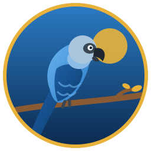
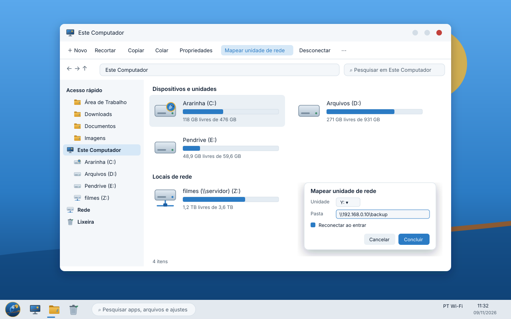

  

<h1 align="center">Ararinha Azul Linux</h1>

  <b>Um sistema operacional brasileiro, construído do zero, que abre de tudo.</b> 
  <i>A Brazilian operating system, built from scratch, that opens anything.</i>

  Codinome <code>Spix</code> · Fase atual: <b>1 — Primeiro Pio</b> · x86_64 e ARM64

---

## Português

O **Ararinha Azul Linux** é um sistema operacional independente: não é baseado em
Ubuntu, Debian, Arch, Fedora nem em nenhuma outra distribuição. Usamos o kernel
Linux (é onde estão os drivers de praticamente todo o hardware do mundo), e todo o
resto é nosso: o sistema de build, o gerenciador de pacotes, o instalador, a
interface gráfica, o gerenciador de arquivos e a identidade visual.

O nome homenageia a ararinha-azul (*Cyanopsitta spixii*), ave da Caatinga baiana
que desapareceu da natureza e foi reintroduzida em Curaçá (BA) em 2022.
O sistema carrega essa ideia: **renascer, voar livre e ser genuinamente brasileiro.**

### Os pilares

| Pilar | O que significa |
|---|---|
| **Abre de tudo** | Dois cliques em `.exe`, `.apk`, `.AppImage`, `.deb`, `.rpm`, `.flatpak` e o sistema escolhe sozinho como executar, isolado e seguro. Apps de Mac em modo experimental. |
| **Arquivos inteligentes, cara de Windows** | Por baixo, um índice com tags, busca instantânea, snapshots e deduplicação. Na frente, o que todo mundo já conhece: **Este Computador**, unidades `C:` e `D:`, **Mapear unidade de rede**. |
| **Hardware sem dor** | Detecta o notebook ou a VM (Acer, Lenovo, Dell, HP, Asus, Positivo, Proxmox, VMware, VirtualBox…) e instala drivers e firmwares sozinho. |
| **Jogos de verdade** | Steam, Proton, monitoramento de CPU e GPU, modo de desempenho com um clique. |
| **Seguro por padrão** | Sistema imutável com atualizações atômicas e rollback, firewall, VPN, criptografia. |
| **Instalável e portátil** | Instale no disco ou leve no pendrive, com persistência criptografada. |
| **Identidade própria** | Interface gráfica desenhada do zero, ícones, sons e temas em torno da ararinha. |

### Primeira proposta visual

### Componentes

| Nome | O que é |
|---|---|
| **Spix Kernel** | Kernel Linux com configuração e otimizações próprias |
| **Ninhada** | Sistema de build que gera o SO inteiro a partir do código-fonte |
| **Pena** | Gerenciador de pacotes (`pena instalar firefox`) |
| **Muda** | Atualizações atômicas, como a ave trocando as penas |
| **Revoada** | Inicialização e serviços (camada sobre o systemd) |
| **Olho de Spix** | Detecção de hardware e drivers automáticos |
| **Bando** | Camada universal que abre qualquer aplicativo |
| **Ninho** | Base de arquivos inteligente e o gerenciador de arquivos |
| **Plumagem** | O shell gráfico: área de trabalho, barra, menu, janelas e temas |
| **Caatinga** | Central de configurações |
| **Primeiro Voo** | Instalador gráfico e criador de pendrive portátil |
| **Asa Guardiã** | Firewall |
| **Rota Migratória** | VPN (WireGuard, OpenVPN, Tailscale) |
| **Canto** | Wi-Fi, rede cabeada, Bluetooth |
| **Rasante** | Modo jogo: desempenho, overlay e monitoramento |
| **Viveiro** | Loja de aplicativos |
| **Grito** | Sons e notificações |

### Documentação

- [Fundamentos: o que aprendemos com os grandes livros](docs/fundamentos.md)
- [Decisões de arquitetura (ADRs)](docs/adr/)
- [Plano e progresso da Fase 1](docs/fases/fase-1.md)
- [Ninhada, o sistema de build](ninhada/README.md)
- [Guia da máquina de build no Proxmox](docs/guias/proxmox.md)
- [Roteiro geral](docs/roteiro.md)
- [Identidade visual](arte/README.md)
- [Limites técnicos, sem promessa falsa](docs/limites.md)

---

## English

**Ararinha Azul Linux** is an independent operating system. It is not based on any
existing distribution. We use the Linux kernel for hardware support; everything
else is ours: build system, package manager, installer, graphical shell, file
manager and visual identity.

Goals: run Windows (`.exe`) and Android (`.apk`) apps transparently, a smart
file layer presented in a familiar Windows-like way (drive letters, *Map network
drive*), automatic drivers, first-class gaming, an immutable and secure base,
installable or portable from a USB drive, in Portuguese and English.

See [docs/](docs/) (Portuguese first, English translations are planned).

---

## Licença / License

Código do sistema sob **GPL-3.0-or-later**, bibliotecas para desenvolvedores sob
**Apache-2.0**, arte sob **CC BY-SA 4.0**. Detalhes em [LICENSE.md](LICENSE.md).

Criado por **Davi Souza**. Veja [CREDITOS.md](CREDITOS.md).
