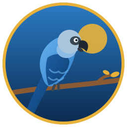
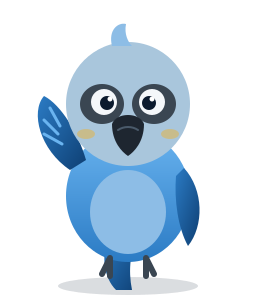

# Identidade visual do Ararinha Azul Linux

Toda a arte aqui é original do projeto, sob **CC BY-SA 4.0**.

## Logo

A ararinha-azul pousada num galho de **caraibeira** (a árvore onde ela faz ninho
na Caatinga), sob o sol dourado do sertão. Detalhes reais da espécie: cabeça
cinza-azulada mais clara que o corpo, pele escura ao redor do olho, bico curvo
escuro e cauda longa.

Usos: ícone do botão do menu, tela de boot, instalador, site. Versões
monocromáticas e só-silhueta serão criadas para tamanhos pequenos (16–24 px).

## Mascote: Mingau

A ararinha mascote do sistema. Aparece no primeiro boot, na documentação e nas
mensagens amigáveis de erro.

## Paleta

| Token | Cor | Origem |
|---|---|---|
| Azul-ararinha | `#2B7BC4` | Penas do corpo |
| Azul-profundo | `#0E3F73` | Asas e cauda |
| Cinza-cabeça | `#A9C6DC` | Cabeça da ave |
| Dourado-caraibeira | `#E8B23A` | Flores da caraibeira |
| Terra-caatinga | `#8A5A33` | Galhos e solo |
| Verde-Curaçá | `#3E8E6A` | Mata ciliar do rio, onde a ave foi reintroduzida |
| Noite-sertão | `#0B1A2E` | Céu noturno, texto principal |

## Temas
Arquivos em [`temas/`](temas/) com os *design tokens* (cores, raios, espaços,
tipografia) lidos por toda a Plumagem.

| Tema | Modo | Status |
|---|---|---|
| Spix | claro | tokens prontos |
| Noite no Sertão | escuro | tokens prontos |
| Caraibeira | claro, dourado | a fazer |
| Caatinga Seca | claro, terroso | a fazer |
| Curaçá | escuro, verde | a fazer |
| Alto Contraste | acessibilidade | a fazer |

## Ícones
Estilo: formas simples, gradiente vertical leve, cantos arredondados, um detalhe
temático discreto (pena, folha, sol) apenas nos ícones de destaque. Grade de
64×64 com versão simplificada em 16, 24 e 32 px. Seguem a especificação de temas
de ícones do freedesktop.org para apps de terceiros encontrarem os nomes padrão.

Primeiros ícones em [`icones/`](icones/): Este Computador, unidade do sistema (C:),
unidade de disco, unidade de rede, pasta e lixeira.

## Sons (Grito)
Sintetizados, inspirados no chamado da ave, em [`sons/grito-padrao/`](sons/grito-padrao/):
`sessao-iniciada`, `notificacao`, `erro`, `dispositivo-conectado`,
`dispositivo-removido`, `desligar`. Gerados por
[`ferramentas/arte/sintetizar-sons.py`](../ferramentas/arte/sintetizar-sons.py).

## Tipografia
Interface em **Inter** e terminal em **JetBrains Mono** (ambas OFL). Ver ADR 0013.

## Mockups
- [Este Computador (Ninho)](mockups/este-computador.svg): primeira proposta do
  gerenciador de arquivos com unidades C:/D: e unidade de rede mapeada.
